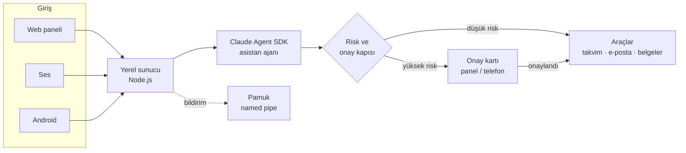

Zepul AI, kendi bilgisayarımda çalışan kişisel asistanım. Takvim, e-posta, belgeler ve günlük işlerle uğraşır; tarayıcıdan, sesle ya da telefondan konuşulur. Asıl önemsediğim kısım güven: asistanın yaptığı her işlem bir risk kapısından geçer ve riskli olanlar benim onayım olmadan çalışmaz.

> Bu depo **kod içermez**. Zepul AI kişisel verilerle çalıştığı için kaynak kodu herkese açık değildir; bu sayfa ne yaptığını ve nasıl kurulduğunu anlatır. Ajan orkestrası tarafı açık: [Zepul OS](https://github.com/dalezepul/zepul-os-orkestra).

## Neler yapar

| | |
|---|---|
| 🖥️ **Web paneli** | Sohbet, görevler, ayarlar ve onay kartları tek yerde |
| 🎙️ **Sesli sohbet** | Konuşarak soru sorma, sesli yanıt |
| 📱 **Android uygulaması** | Telefondan asistana erişim |
| 🔔 **Masaüstü bildirimleri** | Hatırlatma ve sorular masaüstü yoldaşı [Pamuk](https://github.com/dalezepul/pamuk) üzerinden balonla gelir |
| 🚦 **Risk ve onay kapısı** | Her araç çağrısı risk düzeyine göre sınıflandırılır; geri alınamaz işler onay bekler |
| 🧪 **Testler** | Yüzlerce test dosyası; onay kapısı senaryoları öncelikli |

## Mimari

## Tasarım kararları

- **Yerelde çalışır:** sunucu, veriler ve anahtarlar kendi bilgisayarımda durur.
- **Riskli iş onay bekler:** gönderme, silme, yayınlama gibi geri alınması zor işlemler kapıdan onaysız geçmez; bulunan hedef istenenden riskliyse işlem yapılmaz.
- **Kapı testlerle korunur:** onay kapısının kuralları otomatik testlerle sabitlenmiştir.

## Teknoloji

TypeScript · Node.js · Claude Agent SDK · WebSocket · Edge TTS · IMAP/SMTP · Android (Java)
